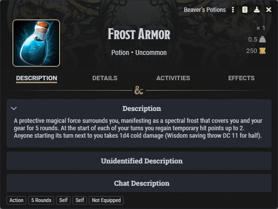
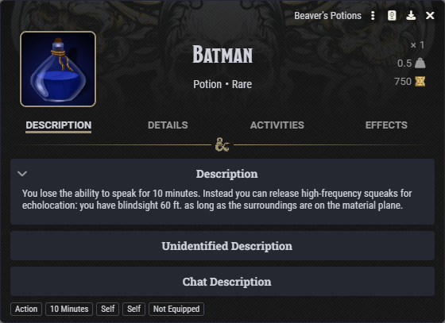
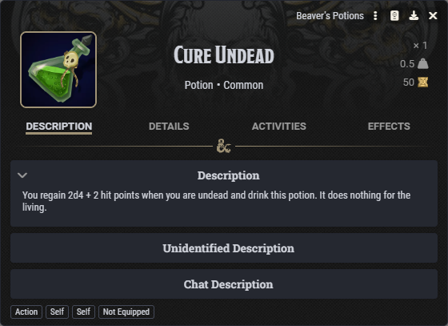

# Beaver's Potions
50 additional magical potions for dnd5e, the mushrooms to brew them and recipes for [Beaver's Crafting](https://github.com/AngryBeaver/beavers-crafting).

For D&D 5e, Level Up A5E, Pathfinder 1e, Pathfinder 2e and D&D 3.5 SRD.

The potions work with the game system alone: no midi-qol, DAE, item macro, Active Auras or Token Magic needed.
Most of them do what they describe when they are drunk; the others put a reminder effect with the right duration on you.

## Screenshots
| Frost Armor | Batman | Cure Undead |
|---|---|---|
|  |  |  |

## Compendiums
- **Potions**: the 50 potions
- **Ingredients**: 22 mushrooms, Magical Essence, and the "Any Mushroom" / "Any Potion" choices for recipes
- **Recipes**: a recipe for every potion and the SRD healing potions, "Gather Essence" (turn a potion into Magical Essence,
  the rarer the potion the more essence) and random potions by rarity (needs Beaver's Crafting)
- **Random Potions**: a roll table per rarity

## Compatibility
| System | Foundry | Compendiums | How the potions work there |
|---|---|---|---|
| D&D 5e (dnd5e 6) | 14 | Potions, Ingredients, Recipes, Random Potions | activities and active effects |
| Level Up A5E (a5e 1.5) | 14 | the same| actions and active effects with a5e's keys |
| D&D 3.5 SRD (D35E 3) | 14 | the same| a buff on the drinker |
| Pathfinder 1e (pf1 11) | 13 | the same| a buff on the drinker |
| Pathfinder 2e (pf2e 7) | 13 | the same| an effect with rule elements on the drinker |

The potions are written for 5e. In the other systems their rules are translated: advantage becomes +4 (pf1, D35E) or
"roll twice, keep the higher" (pf2e); attacks against you with advantage -4 AC (pf1, D35E) or off-guard (pf2e), with
disadvantage a 20% miss chance (pf1, D35E) or concealed (pf2e); critical hits against you helpless (pf1, D35E), a
critical hit for every hit (pf2e) or a chat message (a5e); exhaustion becomes fatigued / exhausted (pf1, D35E),
drained (pf2e) or fatigue (a5e); hovering a fly speed as fast as you walk (pf2e, D35E). A transformation (Cobra Kai,
Ice Devil) is dnd5e's own polymorph in dnd5e and an effect with the creature's AC, speed, size, blindsight, hit points
(temporary) and attacks elsewhere (pf2e: a battle form); the token shows the creature while it lasts. What a system
has nothing for is left to the Gamemaster, the potion's text says what it does: Cure Disease in a5e, pf1 and D35E
(no diseases), Overload Attunement in pf1 and D35E (no attunement), silenced in pf2e. Which rule works in which system
is checked by the end-to-end test in beavers-testing.

## How the potions work
Drink a potion (its "Drink" activity or action, in pf2e "Use"): its effects are put on you right away, healing is rolled and applied.
The setting "Apply potion effects automatically" turns this off; then use the buttons of the chat card.
Effects end by themselves when their time is up (Foundry's effect durations: in combat at the start of your turn).

| Potion | What it does |
|---|---|
| Aid Greater | +10 hit point maximum for 8 hours, heals 10 |
| Batman | blindsight 60 ft., silenced, 10 minutes |
| Beauty Elixir | advantage on Persuasion, 5 hours |
| Blur | attacks against you have disadvantage (not for attackers with blindsight / truesight), 1 minute |
| Casters Overtime (Greater, Superior, Supreme) | refills spell slots of level 1–2 (3, 4, 5), 1 (2, 3, 4) exhaustion; for one round you are incapacitated, attacks against you have advantage and are critical |
| Cobra Kai | you become a Venomous Snake for 6 hours, then turn back |
| Cure Disease | ends the diseased condition |
| Cure Undead | heals 2d4 + 2, only undead |
| Distortion | every attack against you has a 20% chance to miss (rolled and posted to chat), 1 minute |
| Feral Instinct | advantage on initiative, 8 hours |
| Frost Armor (Greater) | 5 rounds: temporary hit points 2 (6) at the start of your turn; whoever starts its turn next to you takes 1d4 (3d4) cold damage, Wisdom save for half |
| Ice Devil | you become an Ice Devil for 1 minute, then turn back with "Corrupted Mind" for 3 days |
| Keen Sense | expertise in Perception, 1 hour |
| Life Shell (Greater) | 10 (20) temporary hit points |
| Live Essence | target a creature: it takes 3d6 + 3 necrotic damage (Constitution save DC 14 for half), you heal the same amount |
| Messenger's Potion | double speed for 3 hours, then 2 levels of exhaustion |
| Minor Invisibility | invisible, attacks against you have disadvantage, yours advantage; ends after 1 minute or when you move, attack or cast a spell |
| Overconfident | immune to frightened, 10 minutes |
| Overload Attunement | one more attunement slot, 5 days |
| Pass Without Trace | +10 to Stealth, 1 hour |
| Plant Nourishment, Repair Glue | "Pour": no effect on you; "Drink": permanently −1 Wisdom |
| Protection From Death | the first time you would drop to 0 hit points you keep 1, 1 hour |
| Radio Activity | 5 rounds: you glow (green light 25 ft.); everyone starting its turn within 25 ft. (you too) takes 3d6 radiant damage, Constitution save DC 14 for half |
| Reflect Damage | until your next turn, damage from an attacker goes to the attacker instead |
| Regeneration | regain 10 hit points at the start of each of your turns, 1 minute |
| Restoration Lesser | ends blinded, deafened, paralyzed, poisoned or diseased (you choose) |
| Restoration Greater | reduces exhaustion by one or ends charmed, petrified, cursed or a reduced hit point maximum (you choose) |
| Shield of Energy | +2 AC for 1 minute to everyone within 10 ft. of you (you too) |
| Specialist (Mage / Melee / Ranged) | +2 to spell / melee / ranged attacks and damage for 1 minute; speed halved / −2 to Dexterity and Wisdom saves / −2 AC |
| Time Stop | 5 rounds: no damage or healing, speed 0, incapacitated |
| Weightless | hovering, 1 minute |
| Bug Shield, Clone Army, Comfort, Comprehend Languages, Detect Magic, Gold Rush, Liquid Knowledge, Speak Language, Time Travel | the effect is up to the Gamemaster: a reminder effect with the duration |
| Glimpse of Future, Tree Friend | up to the Gamemaster |

Auras, regeneration and damage to other creatures are handled by the Gamemaster's client: a Gamemaster must be connected.

## Brewing with Beaver's Crafting
Beaver's Crafting is optional. With it, give your characters the recipes (or import the compendium "Recipes" into your
world) and the mushrooms; every recipe needs a skill check, gold and mostly Magical Essence.

## Fan Content
Beavers Potions is unofficial Fan Content permitted under the [Fan Content Policy](https://company.wizards.com/en/legal/fancontentpolicy). Not approved/endorsed by Wizards. Portions of the materials used are property of Wizards of the Coast. ©Wizards of the Coast LLC.
The icons are the ones that come with Foundry VTT.

## Development
- `pnpm install`
- `pnpm build` builds the module into `dist/`, `pnpm devbuild` / `pnpm devwatch` into the Foundry install of `devDir` (package.json)
- the compendiums are generated: `pnpm packs:generate` writes `packs-src/` from `tools/potions.mjs` (the potions and
  their rules) and `tools/recipes.mjs` (ingredients, recipes, tables). The build compiles `packs-src/` into LevelDB packs.
  `pnpm packs:extract` pulls compendiums edited in Foundry back into `packs-src/` (they are overwritten by the next generate).
- `tools/systems/<system>.mjs` translates the potions' rules for a system (`tools/support.json`: what it cannot do);
  `src/systems/<system>.js` is the system's part of the runtime (use hook, damage, healing, saves, conditions)
- the rules a system has no effect for are in `src/`, driven by `flags["beavers-potions"]` on the potions and their effects (or buffs):

| Flag | On | |
|---|---|---|
| `potion` | item | a potion of this module: its effects are applied when drunk, its healing applied to the drinker |
| `use.restoreSlots` `{maxLevel, exhaustion}` | item | refill spell slots |
| `use.restoration` `"lesser"`/`"greater"`, `use.cure` `[status]` | item | end conditions |
| `use.drain` `{formula, type, ability, dc}` | item | damage the target, heal the drinker |
| `use.area` `{radius}` | item | apply the effects to everyone within the radius |
| `use.transform` `{seconds, after}`, `use.onlyType` | item | turn back after the time; heal only that creature type |
| `grantsAdvantage`, `grantsDisadvantage` (`"sight"`), `grantsCritical`, `attackAdvantage`, `distortion` | effect | attack rules |
| `reflectDamage`, `invulnerable`, `protectionFromDeath` | effect | damage rules |
| `immune` `[status]` | effect | statuses that stay off (pf1, D35E) |
| `turnStart` `{heal, temp}`, `aura` `{radius, includeSelf, save, damage}` | effect | start of turn |
| `form` `{name, img, tint, size, hp, attacks}` | effect | a transformation outside dnd5e: token image / size, temporary hit points, attack items while it lasts |
| `statuses` `[status]`, `hold` `{path: value}` | effect | statuses / actor data while it lasts (silenced; D35E's senses and shapechange image) |
| `light`, `endOn` `["attack","spell","move"]`, `onEnd` `{exhaustion, revert, createEffect, createData}` | effect | begin / end (`createData`: buffs or effect items) |

- end-to-end test: `node potions/run.mjs` in beavers-testing (every potion is drunk and checked in Foundry)

## Release
A commit on main whose message starts with `release v1.2.3` builds version 1.2.3, publishes it as GitHub release and on foundryvtt.com
(needs the `FOUNDRY_RELEASE_TOKEN` secret) and bumps package.json.
